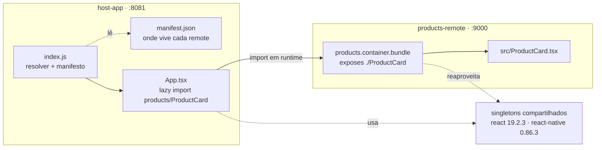
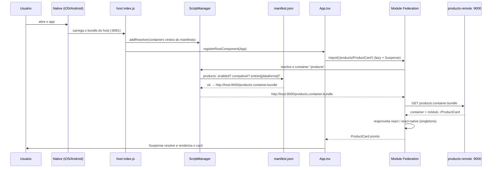

# Module Federation Playground — `mf-runtime`

Demo de **Module Federation v2 em tempo de execução no React Native** (Re.Pack 5 + Rspack).
O `host-app` **não** contém o código do `ProductCard`: ele baixa esse componente do
`products-remote` **pela rede, no momento em que a tela é renderizada**. É isso que o nome
`mf-runtime` destaca — composição em _runtime_, não em build time.

## Visão geral

| App | Porta | Papel | O que faz |
|-----|-------|-------|-----------|
| `host-app` | `8081` | **Host** (consome) | Sobe o app, lê o manifesto e carrega `products/ProductCard` sob demanda |
| `products-remote` | `9000` | **Remote** (expõe) | Publica o container `products.container.bundle` que expõe `./ProductCard` |

Ambos usam `ModuleFederationPluginV2` do Re.Pack e **compartilham `react` e `react-native`
como _singletons_** — uma única instância viva no runtime, usada pelos dois lados.



## O que acontece quando o usuário abre o app

A sequência exata, do toque no ícone até o card aparecer na tela:

1. **Native inicializa** (iOS/Android) e carrega o **bundle principal do host**, servido pelo
   dev server do Re.Pack na porta `8081`.
2. **`host-app/index.js` executa.** Ele registra um _resolver_ no `ScriptManager` — e esse
   resolver monta seu mapa de `containers` **lendo `manifest.json`** — e então chama
   `registerRootComponent(App)`.
3. **`App.tsx` monta.** Ao renderizar, encontra
   `const ProductCard = React.lazy(() => import('products/ProductCard'))`. Enquanto o módulo
   não chega, o `<Suspense>` mostra o fallback **"Loading product..."**.
4. **O Module Federation intercepta o `import('products/ProductCard')`.** Como `products` é um
   remote `dynamic` (declarado no `rspack.config.mjs` do host), o MF pede ao `ScriptManager`
   para **resolver o container `products`**.
5. **O resolver consulta o manifesto:** confirma que o remote `products` está `enabled` e é
   `compatible` com o host, pega o `entries` da plataforma atual e devolve
   `http://<host>:9000/products.container.bundle`. (Se estivesse desativado ou incompatível, o
   host nem tentaria baixar.)
6. **O `ScriptManager` baixa o container** do `products-remote` (porta `9000`).
7. **O runtime do MF negocia as dependências compartilhadas:** `react` e `react-native` são
   _singletons_, então o remote **reaproveita as instâncias já carregadas pelo host** — não
   baixa uma segunda cópia (é o que evita o erro "Invalid hook call" de dois Reacts).
8. **O módulo `./ProductCard` é avaliado** (log `[REMOTE] ProductCard module evaluated`) e
   exportado.
9. **O `Suspense` resolve** e renderiza `<ProductCard />` (log `[REMOTE] ProductCard rendered`),
   exibindo o card **"MacBook Pro"**.



## Arquivos que são executados (em ordem)

"Os files que ele bate para executar", do boot ao render:

| # | Arquivo | Papel |
|---|---------|-------|
| 1 | `host-app/index.js` | **Entrypoint do host.** Registra o resolver do `ScriptManager` (lendo o manifesto) e monta o `App`. |
| 2 | `host-app/manifest.json` | **Fonte da verdade.** Quais remotes existem e a URL base de cada um, por plataforma. |
| 3 | `host-app/rspack.config.mjs` | **Build do host.** Declara o remote `products@dynamic` e os _singletons_ compartilhados. |
| 4 | `host-app/App.tsx` | **UI do host.** Faz o `lazy import` de `products/ProductCard` dentro de `<Suspense>`. |
| 5 | `host-app/federated.d.ts` | **Tipos TS** do módulo virtual `products/ProductCard`. |
| 6 | `products-remote/rspack.config.mjs` | **Build do remote.** `exposes: './ProductCard'`, gera `products.container.bundle`. |
| 7 | `products-remote/src/ProductCard.tsx` | **O componente** de fato exposto e renderizado dentro do host. |

## O manifesto

Antes, a URL do remote ficava _hardcoded_ dentro do `index.js`. Agora os dados moram no
**`host-app/manifest.json`** — mesmo formato do manifesto de produção do `todo-mf` — e o host
só lê de lá:

```json
{
  "schema": 1,
  "channel": "dev",
  "remotes": {
    "products": {
      "enabled": true,
      "container": "products",
      "releaseId": "products-dev-local",
      "entries": {
        "ios": "http://localhost:9000/products.container.bundle",
        "android": "http://10.0.2.2:9000/products.container.bundle"
      },
      "compatibility": {
        "runtimeApi": 1,
        "contract": "1.0.0",
        "react": "19.2.3",
        "reactNative": "0.86.3",
        "minHostVersion": "1.0.0",
        "maxHostVersionExclusive": "2.0.0"
      }
    }
  }
}
```

### O que cada campo significa

| Campo | Para que serve |
|-------|----------------|
| `schema` | Versão do formato do manifesto. O host valida isso antes de confiar no resto. |
| `channel` | Trilha de release (`dev` / `staging` / `production`). Permite servir bundles diferentes por público sem mudar o app. |
| `remotes` | Mapa dos remotes que o host conhece. A **chave** (`products`) é o nome usado no `import('products/ProductCard')`. |
| `enabled` | Liga/desliga o remote **remotamente**. Com `false`, o host nem tenta baixar — _feature flag_ de bundle. |
| `container` | Nome do container no Module Federation (o `name` do `ModuleFederationPluginV2` do remote). |
| `releaseId` | Identidade da versão publicada. Serve para logs, telemetria e cache. |
| `entries` | **Onde** o bundle do container vive, por plataforma. É o dado que resolve a URL. |
| `compatibility` | **Contrato** entre host e remote: só carrega se o host souber falar com aquele remote. |
| ↳ `runtimeApi` | Versão do protocolo de carregamento. Incompatível → não carrega. |
| ↳ `contract` | Versão da interface de props/API compartilhada entre host e remote. |
| ↳ `react` / `reactNative` | Versões que o remote espera encontrar como _singleton_ no host. |
| ↳ `minHostVersion` / `maxHostVersionExclusive` | Faixa de versões do **app host** que podem carregar este remote (gate de produção do `todo-mf`). |

### Como o `index.js` consome o manifesto

O host percorre os remotes, **descarta os desativados e os incompatíveis**, e só então monta
o template de URL que o `ScriptManager` vai resolver:

```js
import manifest from './manifest.json';

// O que este build do host sabe falar. Remote que pedir algo diferente é ignorado.
const HOST_CONTRACT = { runtimeApi: 1, react: '19.2.3', reactNative: '0.86.3' };
const platform = Platform.OS === 'android' ? 'android' : 'ios';

const containers = Object.fromEntries(
  Object.entries(manifest.remotes)
    .filter(([name, remote]) => remote.enabled && isCompatible(name, remote.compatibility))
    .map(([name, remote]) => {
      const entry = remote.entries[platform] ?? remote.entries.ios;
      const baseUrl = entry.slice(0, entry.lastIndexOf('/')); // tira o nome do arquivo
      return [name, `${baseUrl}/[name][ext]`];
    }),
);

const resolveURL = Federated.createURLResolver({ containers });
```

Ou seja, o manifesto exerce **três decisões de runtime**:

1. **Se carrega** — `enabled` (feature flag) e `compatibility` (gate de versão).
2. **De onde carrega** — `entries[plataforma]` vira a URL base do container.
3. **Qual versão** — `releaseId` / `channel` identificam o que está no ar.

**Por que isso importa:** para apontar o host para outra máquina, um túnel ou um CDN — ou para
desligar um remote com problema — você edita só o manifesto; o host **não precisa ser
rebuildado**. Esse é o primeiro passo da entrega de módulos sem passar pela loja. A versão de
produção (manifestos por canal, CDN e checagem de faixa de versão) está no projeto `todo-mf`
deste mesmo repositório, publicada em **AWS S3 + CloudFront**.

## Como o host encontra o remote

- **`[name][ext]`** no template é preenchido pelo Re.Pack na hora: `[name]` vira o nome do
  container/chunk (`products.container`) e `[ext]` a extensão (`.bundle`), resultando em
  `products.container.bundle`.
- **`10.0.2.2` no Android:** é o alias que o emulador Android usa para alcançar o `localhost`
  da máquina de desenvolvimento. No iOS/web, `localhost` resolve direto.
- **`cache: false`** no resolver: a cada launch o host rebusca o bundle do remote, então uma
  mudança no remote aparece no próximo reload sem tocar no host.

## Dependências compartilhadas (singletons)

Bloco **idêntico** nos dois `rspack.config.mjs` — é o contrato entre host e remote:

```js
shared: {
  react: { singleton: true, eager: true, requiredVersion: '19.2.3' },
  'react-native': {
    singleton: true,
    eager: true,
    requiredVersion: '0.86.3',
  },
}
```

- `singleton: true` → uma única instância no runtime. Dois Reacts quebrariam os hooks.
- `eager: true` → carrega junto do bundle inicial (apropriado para libs de base).
- `requiredVersion` → se host e remote divergirem de versão, o MF avisa/falha.

## Como rodar

Em **dois terminais** (suba o remote primeiro):

```bash
# Terminal 1 — remote (porta 9000)
cd products-remote
npm install
npm start

# Terminal 2 — host (porta 8081)
cd host-app
npm install
npm start
npm run android   # ou: npm run ios
```

Com o app aberto, os logs `[REMOTE] ProductCard module evaluated` / `rendered` confirmam que
o componente veio do remote. Edite `products-remote/src/ProductCard.tsx`, salve e recarregue o
host: o card muda **sem rebuildar o host**.

## Próximo passo: produção

Este demo resolve o remote em `localhost`. Para entregar bundles de verdade (CDN, canais de
release, telemetria e _fallback_ quando o remote está offline), veja o projeto **`todo-mf`**,
que publica os manifestos e o remote em **AWS S3 + CloudFront**.
