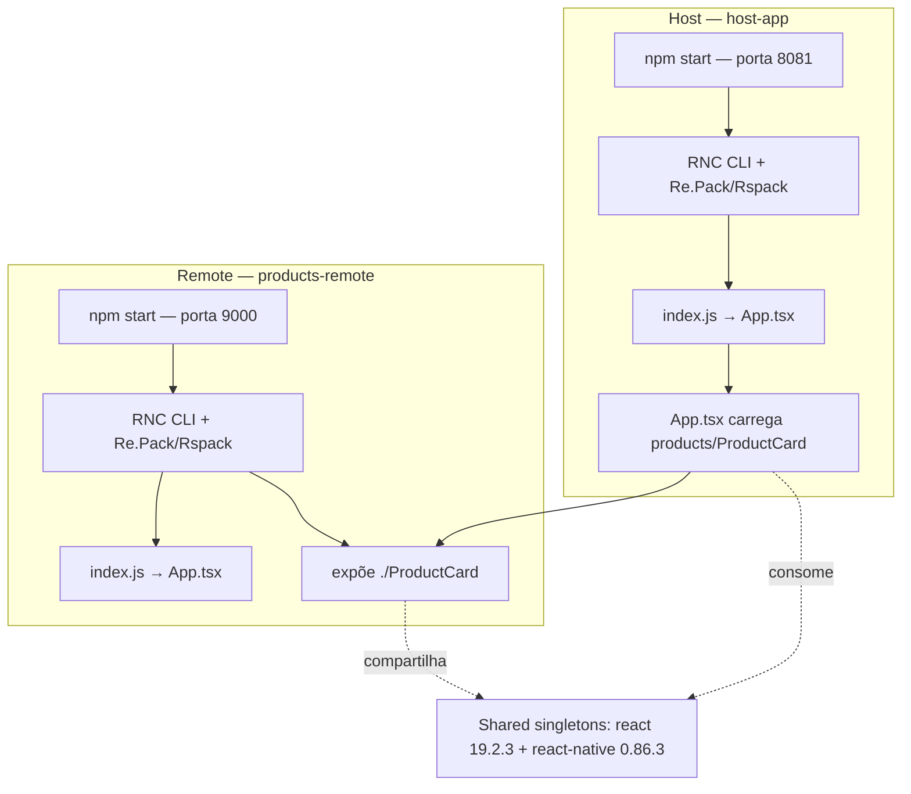

# Module Federation Playground

## Arquitetura atual

O `host-app` inicia na porta `8081` e carrega o componente `ProductCard` exposto pelo `products-remote`, que inicia na porta `9000`. Ambos usam Module Federation v2 do Re.Pack e compartilham `react` e `react-native` como singletons.



O host resolve o bundle do remote por `ScriptManager`; no emulador Android, o endereço usa `10.0.2.2` para alcançar a máquina de desenvolvimento. O remote também mantém seu `App.tsx` para execução independente.

### Configuração das dependências compartilhadas

Este bloco está nos dois arquivos `rspack.config.mjs`:

```js
shared: {
  react: { singleton: true, eager: true, requiredVersion: '19.2.3' },
  'react-native': {
    singleton: true,
    eager: true,
    requiredVersion: '0.86.3',
  },
}
```
