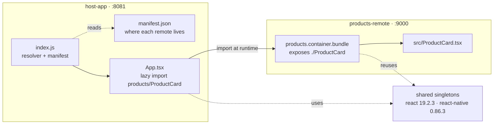
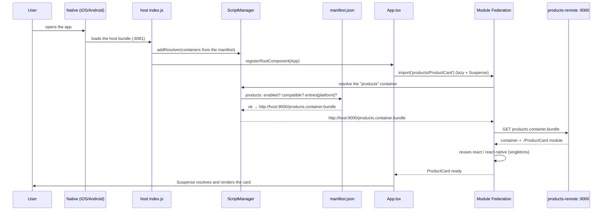

# Module Federation Playground — `mf-runtime`

A demo of **runtime Module Federation v2 on React Native** (Re.Pack 5 + Rspack).
The `host-app` does **not** contain the `ProductCard` code: it downloads that component from
`products-remote` **over the network, at the moment the screen renders**. That is what the name
`mf-runtime` highlights — composition at _runtime_, not at build time.

## Overview

| App | Port | Role | What it does |
|-----|------|------|--------------|
| `host-app` | `8081` | **Host** (consumer) | Boots the app, reads the manifest and loads `products/ProductCard` on demand |
| `products-remote` | `9000` | **Remote** (producer) | Publishes the `products.container.bundle` container that exposes `./ProductCard` |

Both use Re.Pack's `ModuleFederationPluginV2` and **share `react` and `react-native` as
_singletons_** — a single live instance in the runtime, used by both sides.



## What happens when the user opens the app

The exact sequence, from the tap on the icon to the card on screen:

1. **Native boots** (iOS/Android) and loads the **host's main bundle**, served by the Re.Pack
   dev server on port `8081`.
2. **`host-app/index.js` runs.** It registers a _resolver_ on the `ScriptManager` — and that
   resolver builds its `containers` map **by reading `manifest.json`** — then calls
   `registerRootComponent(App)`.
3. **`App.tsx` mounts.** While rendering, it hits
   `const ProductCard = React.lazy(() => import('products/ProductCard'))`. Until the module
   arrives, `<Suspense>` shows the **"Loading product..."** fallback.
4. **Module Federation intercepts `import('products/ProductCard')`.** Since `products` is a
   `dynamic` remote (declared in the host's `rspack.config.mjs`), MF asks the `ScriptManager`
   to **resolve the `products` container**.
5. **The resolver consults the manifest:** it confirms the `products` remote is `enabled` and
   `compatible` with the host, takes the `entries` for the current platform and returns
   `http://<host>:9000/products.container.bundle`. (If it were disabled or incompatible, the
   host would not even try to download it.)
6. **The `ScriptManager` downloads the container** from `products-remote` (port `9000`).
7. **MF's runtime negotiates the shared dependencies:** `react` and `react-native` are
   _singletons_, so the remote **reuses the instances already loaded by the host** — it does
   not download a second copy (this is what avoids the "Invalid hook call" error from two Reacts).
8. **The `./ProductCard` module is evaluated** (log `[REMOTE] ProductCard module evaluated`)
   and exported.
9. **`Suspense` resolves** and renders `<ProductCard />` (log `[REMOTE] ProductCard rendered`),
   showing the **"MacBook Pro"** card.



## Files executed (in order)

The files it hits to run, from boot to render:

| # | File | Role |
|---|------|------|
| 1 | `host-app/index.js` | **Host entrypoint.** Registers the `ScriptManager` resolver (reading the manifest) and mounts `App`. |
| 2 | `host-app/manifest.json` | **Source of truth.** Which remotes exist and the base URL of each, per platform. |
| 3 | `host-app/rspack.config.mjs` | **Host build.** Declares the `products@dynamic` remote and the shared _singletons_. |
| 4 | `host-app/App.tsx` | **Host UI.** Does the `lazy import` of `products/ProductCard` inside `<Suspense>`. |
| 5 | `host-app/federated.d.ts` | **TS types** for the virtual `products/ProductCard` module. |
| 6 | `products-remote/rspack.config.mjs` | **Remote build.** `exposes: './ProductCard'`, produces `products.container.bundle`. |
| 7 | `products-remote/src/ProductCard.tsx` | **The component** actually exposed and rendered inside the host. |

## The manifest

Previously the remote URL was _hardcoded_ inside `index.js`. Now the data lives in
**`host-app/manifest.json`** — the same shape as the `todo-mf` production manifest — and the
host only reads from there:

```json
{
  "schema": 1,
  "channel": "dev",
  "remotes": {
    "products": {
      "enabled": true,
      "container": "products",
      "releaseId": "products-dev-local",
      "entries": {
        "ios": "http://localhost:9000/products.container.bundle",
        "android": "http://10.0.2.2:9000/products.container.bundle"
      },
      "compatibility": {
        "runtimeApi": 1,
        "contract": "1.0.0",
        "react": "19.2.3",
        "reactNative": "0.86.3",
        "minHostVersion": "1.0.0",
        "maxHostVersionExclusive": "2.0.0"
      }
    }
  }
}
```

### What each field means

| Field | What it's for |
|-------|---------------|
| `schema` | Version of the manifest format. The host validates it before trusting the rest. |
| `channel` | Release track (`dev` / `staging` / `production`). Lets you serve different bundles per audience without changing the app. |
| `remotes` | Map of the remotes the host knows about. The **key** (`products`) is the name used in `import('products/ProductCard')`. |
| `enabled` | Turns the remote on/off **remotely**. With `false`, the host doesn't even try to download it — a bundle _feature flag_. |
| `container` | The container name in Module Federation (the remote's `ModuleFederationPluginV2` `name`). |
| `releaseId` | Identity of the published version. Used for logs, telemetry and caching. |
| `entries` | **Where** the container bundle lives, per platform. This is the data that resolves the URL. |
| `compatibility` | **Contract** between host and remote: it only loads if the host can talk to that remote. |
| ↳ `runtimeApi` | Version of the loading protocol. Incompatible → no load. |
| ↳ `contract` | Version of the props/API interface shared between host and remote. |
| ↳ `react` / `reactNative` | Versions the remote expects to find as a _singleton_ on the host. |
| ↳ `minHostVersion` / `maxHostVersionExclusive` | Range of **host app** versions allowed to load this remote (the `todo-mf` production gate). |

### How `index.js` consumes the manifest

The host walks the remotes, **drops the disabled and incompatible ones**, and only then builds
the URL template the `ScriptManager` will resolve:

```js
import manifest from './manifest.json';

// What this host build can talk to. A remote asking for anything else is ignored.
const HOST_CONTRACT = { runtimeApi: 1, react: '19.2.3', reactNative: '0.86.3' };
const platform = Platform.OS === 'android' ? 'android' : 'ios';

const containers = Object.fromEntries(
  Object.entries(manifest.remotes)
    .filter(([name, remote]) => remote.enabled && isCompatible(name, remote.compatibility))
    .map(([name, remote]) => {
      const entry = remote.entries[platform] ?? remote.entries.ios;
      const baseUrl = entry.slice(0, entry.lastIndexOf('/')); // strip the filename
      return [name, `${baseUrl}/[name][ext]`];
    }),
);

const resolveURL = Federated.createURLResolver({ containers });
```

So the manifest drives **three runtime decisions**:

1. **Whether it loads** — `enabled` (feature flag) and `compatibility` (version gate).
2. **Where it loads from** — `entries[platform]` becomes the container's base URL.
3. **Which version** — `releaseId` / `channel` identify what's live.

**Why this matters:** to point the host at another machine, a tunnel or a CDN — or to turn off
a misbehaving remote — you edit only the manifest; the host **does not need to be rebuilt**.
This is the first step toward delivering modules without going through the app store. The
production version (per-channel manifests, CDN and version-range checks) lives in the `todo-mf`
project in this same repository, published to **AWS S3 + CloudFront**.

## How the host finds the remote

- **`[name][ext]`** in the template is filled in by Re.Pack on the fly: `[name]` becomes the
  container/chunk name (`products.container`) and `[ext]` the extension (`.bundle`), yielding
  `products.container.bundle`.
- **`10.0.2.2` on Android:** the alias the Android emulator uses to reach the development
  machine's `localhost`. On iOS/web, `localhost` resolves directly.
- **`cache: false`** in the resolver: on every launch the host re-fetches the remote bundle, so
  a change in the remote shows up on the next reload without touching the host.

## Shared dependencies (singletons)

An **identical** block in both `rspack.config.mjs` files — the contract between host and remote:

```js
shared: {
  react: { singleton: true, eager: true, requiredVersion: '19.2.3' },
  'react-native': {
    singleton: true,
    eager: true,
    requiredVersion: '0.86.3',
  },
}
```

- `singleton: true` → a single instance in the runtime. Two Reacts would break the hooks.
- `eager: true` → loaded with the initial bundle (appropriate for base libraries).
- `requiredVersion` → if host and remote diverge in version, MF warns/fails.

## How to run

In **two terminals** (start the remote first):

```bash
# Terminal 1 — remote (port 9000)
cd products-remote
npm install
npm start

# Terminal 2 — host (port 8081)
cd host-app
npm install
npm start
npm run android   # or: npm run ios
```

With the app open, the logs `[REMOTE] ProductCard module evaluated` / `rendered` confirm the
component came from the remote. Edit `products-remote/src/ProductCard.tsx`, save and reload the
host: the card changes **without rebuilding the host**.

## Next step: production

This demo resolves the remote at `localhost`. To deliver real bundles (CDN, release channels,
telemetry and a _fallback_ when the remote is offline), see the **`todo-mf`** project, which
publishes the manifests and the remote to **AWS S3 + CloudFront**. The production delivery flow
for this project is documented in [`release/`](./release/README.md).
```
