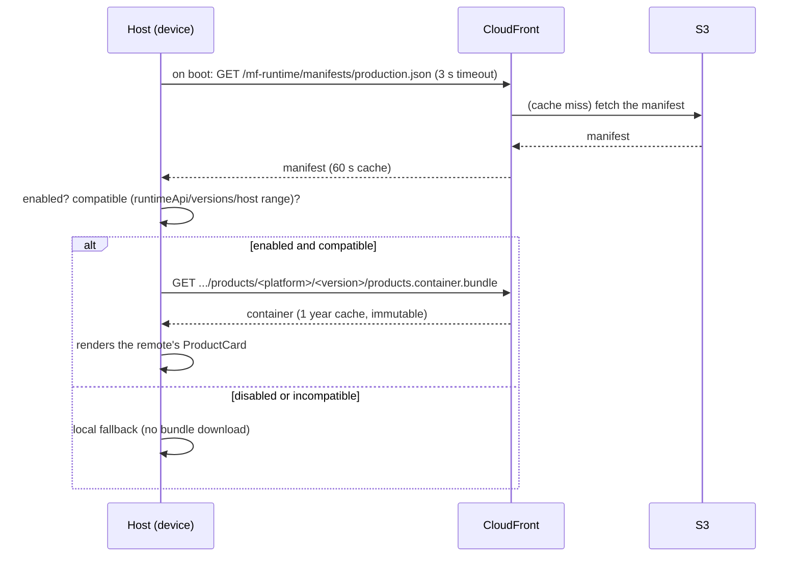

# `release/` — shipping the remote in production (S3 + CloudFront)

This folder is the **production** layer of `mf-runtime`. It answers the question: *"if the
manifest is embedded in the host, how do I update it without rebuilding the app?"* — by taking
the manifest out of the bundle and putting it on a **CDN**, where the host fetches it at runtime.

## The principle

- The **host** is the app installed from the store — a shell that barely changes.
- The **remote** (`products`) is **JavaScript downloaded at runtime**.
- A **per-channel manifest** (`dev` / `staging` / `production`), served by the **CDN (S3 +
  CloudFront)**, decides **which version** of the remote each app loads, **whether** it loads
  (`enabled`), and **for whom** (host version range in `compatibility`).

Everything that isn't host code becomes updatable **without going through the store**.

## Files

| File | What it is |
|------|------------|
| `manifest.dev.json` | Dev channel — remote at `localhost:9000` (the same one the host embeds today). |
| `manifest.staging.json` | Staging channel — tests the **next** version of the remote on the CDN. |
| `manifest.prod.json` | Production channel — the stable version on the CDN. |
| `publish-remote.sh` | Builds the remote container and uploads the bundles (immutable per version). |
| `publish-manifest.sh` | Validates and publishes a channel's manifest (the only mutable file). |
| `cdn.env.example` | Template for the CDN config. Copy to `cdn.env` (not committed). |

## Bucket layout

```text
<bucket>/mf-runtime/
├── manifests/
│   ├── staging.json            # MUTABLE · Cache-Control: public, max-age=60
│   └── production.json         # MUTABLE · Cache-Control: public, max-age=60
└── products/                   # remote bundles
    ├── ios/<version>/products.container.bundle + chunks + assets
    └── android/<version>/...   # IMMUTABLE · Cache-Control: max-age=31536000, immutable
```

**Golden rules:**
1. **Only the manifest is mutable.** A 60 s cache → rollback/kill-switch reaches clients fast.
2. **Bundles live in a per-version folder and are never overwritten.** New version = new folder.
3. **The manifest is uploaded last**, after the bundles — no app ever receives a URL that
   doesn't exist yet.
4. **Sourcemaps** never go to the public CDN.

## The exact flow

### Step A — publish a new version of the remote

```bash
# builds the container (ios + android) and uploads to products/<platform>/1.2.0/
release/publish-remote.sh 1.2.0
```
This produces `products.container.bundle` + chunks and runs `aws s3 sync` to the **immutable**
folder `mf-runtime/products/<platform>/1.2.0/`. Nothing points to it yet.

### Step B — point the manifest and publish

```bash
# 1. edit release/manifest.prod.json:
#      remotes.products.releaseId  → "products-1.2.0"
#      remotes.products.entries    → .../products/<platform>/1.2.0/products.container.bundle
# 2. validate without touching AWS (schema, channel, HTTPS in entries)
DRY_RUN=1 release/publish-manifest.sh production
# 3. publish (overwrites mf-runtime/manifests/production.json, 60 s cache)
release/publish-manifest.sh production
# 4. check what the CDN serves
curl -s "$CDN_URL/manifests/production.json" | jq '.remotes.products.releaseId'
```

### Step C — what the app does, on its own, on the next launch



- Only the **manifest** changes between config releases; the host **does not go through the
  store**.
- CloudFront honors `max-age=60`: within 1 min every edge serves the new manifest, **with no
  invalidation**.
- The app reads the manifest **once per run**. Anyone with the app already open only sees the
  change on relaunch.

## Operations (no host rebuild)

| Action | How | Effect |
|--------|-----|--------|
| **Kill switch** | publish the manifest with `enabled: false` | everyone falls back to local on next launch |
| **Rollback** | publish the manifest with the previous version's `releaseId`/`entries` | reverts without the store (the old bundle is still there, immutable) |
| **New release** | `publish-remote.sh` new version → point manifest → `publish-manifest.sh` | rolls out the new version |
| **Require a new host** | bump `minHostVersion` | old apps fall back **before** downloading the bundle; only a new host in the store fixes it |

## The host side (what's left to wire in the demo)

Today `host-app/index.js` **embeds** the manifest:
```js
import manifest from './manifest.json';   // read from the bundle, at build time
```
To consume this folder, the host instead **fetches the manifest from the CDN on boot**, with the
embedded one as an offline fallback:

```js
const CDN_URL = 'https://d111111abcdef8.cloudfront.net/mf-runtime';
const CHANNEL = 'production'; // injected at build per channel
import embedded from './manifest.json';

async function loadManifest() {
  try {
    const res = await fetch(`${CDN_URL}/manifests/${CHANNEL}.json`, {
      signal: AbortSignal.timeout(3000),
    });
    if (!res.ok) throw new Error(`HTTP ${res.status}`);
    const manifest = await res.json();
    if (manifest.channel !== CHANNEL) throw new Error('channel mismatch');
    return manifest;                       // ← manifest from the CDN
  } catch (e) {
    console.warn('[release] remote manifest unavailable, using the embedded one', e);
    return embedded;                       // ← fallback
  }
}
```
From there, the same `filter` by `enabled` + `compatibility` (already in `index.js`) builds the
`ScriptManager` resolver. `todo-mf` does exactly this in `apps/host/release/manifest.ts`.

## Initial setup (once)

```bash
cp release/cdn.env.example release/cdn.env
# fill in CDN_BUCKET, CDN_URL, CDN_PREFIX, CDN_AWS_PROFILE, CDN_ACCOUNT_ID
```

AWS infra (summary): **private** bucket, access only via **CloudFront OAC**, distribution with
*redirect HTTP→HTTPS* and the `CachingOptimized` cache policy. The cache honors each file's
`Cache-Control` — which is why **no invalidation is needed**.
```
