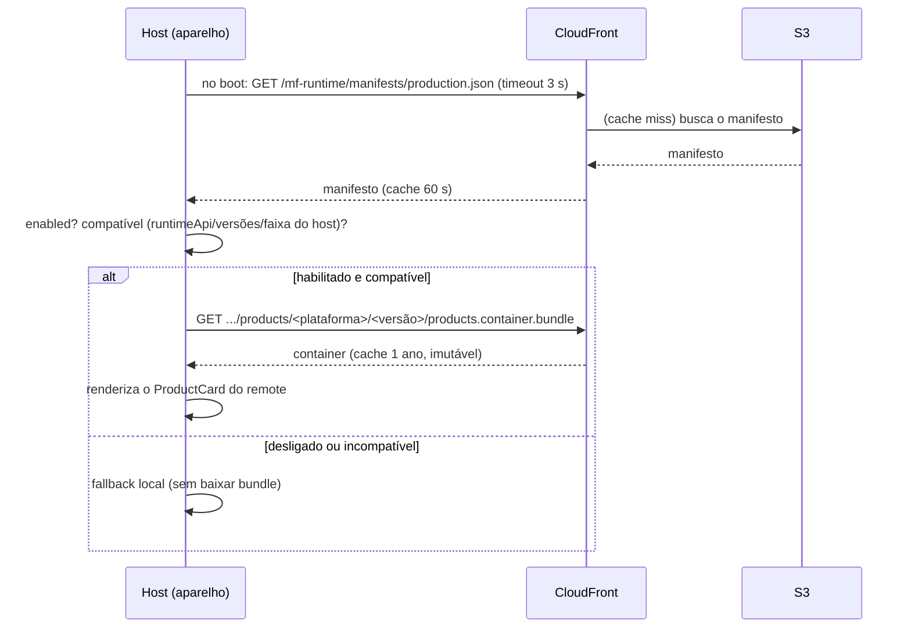

# `release/` — entrega do remote em produção (S3 + CloudFront)

Esta pasta é a camada de **produção** do `mf-runtime`. Ela responde à pergunta: *"se o
manifesto fica embutido no host, como eu atualizo sem rebuildar o app?"* — tirando o manifesto
de dentro do bundle e colocando numa **CDN**, de onde o host o busca em runtime.

## O princípio

- O **host** é o app instalado pela loja — uma casca que quase não muda.
- O **remote** (`products`) é **JavaScript baixado em runtime**.
- Um **manifesto por canal** (`dev` / `staging` / `production`), servido pela **CDN (S3 +
  CloudFront)**, decide **qual versão** do remote cada app carrega, **se** carrega (`enabled`) e
  **para quem** (faixa de versão do host em `compatibility`).

Tudo que não é código do host passa a ser atualizável **sem passar pela loja**.

## Arquivos

| Arquivo | O quê |
|---------|-------|
| `manifest.dev.json` | Canal dev — remote em `localhost:9000` (o mesmo que o host embute hoje). |
| `manifest.staging.json` | Canal staging — testa a **próxima** versão do remote na CDN. |
| `manifest.prod.json` | Canal produção — a versão estável na CDN. |
| `publish-remote.sh` | Builda o container do remote e sobe os bundles (imutável por versão). |
| `publish-manifest.sh` | Valida e publica o manifesto de um canal (único arquivo mutável). |
| `cdn.env.example` | Modelo da config da CDN. Copie para `cdn.env` (não commitado). |

## Layout do bucket

```text
<bucket>/mf-runtime/
├── manifests/
│   ├── staging.json            # MUTÁVEL · Cache-Control: public, max-age=60
│   └── production.json         # MUTÁVEL · Cache-Control: public, max-age=60
└── products/                   # bundles do remote
    ├── ios/<versão>/products.container.bundle + chunks + assets
    └── android/<versão>/...    # IMUTÁVEL · Cache-Control: max-age=31536000, immutable
```

**Regras de ouro:**
1. **Só o manifesto é mutável.** Cache de 60 s → rollback/kill-switch chega rápido.
2. **Bundles ficam em pasta por versão e nunca são sobrescritos.** Versão nova = pasta nova.
3. **O manifesto sobe por último**, depois dos bundles — nenhum app recebe uma URL que ainda
   não existe.
4. **Sourcemaps** nunca vão para a CDN pública.

## O flow exato

### Etapa A — publicar uma versão nova do remote

```bash
# builda o container (ios + android) e sobe para products/<plataforma>/1.2.0/
release/publish-remote.sh 1.2.0
```
Isso gera `products.container.bundle` + chunks e faz `aws s3 sync` para a pasta **imutável**
`mf-runtime/products/<plataforma>/1.2.0/`. Nada aponta para ela ainda.

### Etapa B — apontar o manifesto e publicar

```bash
# 1. editar release/manifest.prod.json:
#      remotes.products.releaseId  → "products-1.2.0"
#      remotes.products.entries    → .../products/<plataforma>/1.2.0/products.container.bundle
# 2. validar sem tocar na AWS (schema, canal, HTTPS nas entries)
DRY_RUN=1 release/publish-manifest.sh production
# 3. publicar (sobrescreve mf-runtime/manifests/production.json, cache 60 s)
release/publish-manifest.sh production
# 4. conferir o que a CDN serve
curl -s "$CDN_URL/manifests/production.json" | jq '.remotes.products.releaseId'
```

### Etapa C — o que o app faz, sozinho, na próxima abertura



- Só o **manifesto** muda entre releases de config; o host **não passa pela loja**.
- O CloudFront respeita o `max-age=60`: em até 1 min todos os pontos de presença servem o
  manifesto novo, **sem invalidation**.
- O app lê o manifesto **uma vez por execução**. Quem está com o app aberto só vê a mudança ao
  reabrir.

## Operações (sem rebuild do host)

| Ação | Como | Efeito |
|------|------|--------|
| **Kill switch** | publicar o manifesto com `enabled: false` | todos caem no fallback na próxima abertura |
| **Rollback** | publicar o manifesto com o `releaseId`/`entries` da versão anterior | volta sem loja (o bundle antigo ainda está lá, imutável) |
| **Novo release** | `publish-remote.sh` nova versão → apontar manifesto → `publish-manifest.sh` | rollout da versão nova |
| **Exigir host novo** | subir `minHostVersion` | apps antigos caem no fallback **antes** de baixar o bundle; só resolve publicando host novo na loja |

## O lado do host (o que falta ligar no demo)

Hoje o `host-app/index.js` **embute** o manifesto:
```js
import manifest from './manifest.json';   // lido do bundle, no build
```
Para consumir esta pasta, o host passa a **buscar o manifesto da CDN no boot**, com o embutido
como fallback offline:

```js
const CDN_URL = 'https://d111111abcdef8.cloudfront.net/mf-runtime';
const CHANNEL = 'production'; // injetado no build por canal
import embedded from './manifest.json';

async function loadManifest() {
  try {
    const res = await fetch(`${CDN_URL}/manifests/${CHANNEL}.json`, {
      signal: AbortSignal.timeout(3000),
    });
    if (!res.ok) throw new Error(`HTTP ${res.status}`);
    const manifest = await res.json();
    if (manifest.channel !== CHANNEL) throw new Error('canal divergente');
    return manifest;                       // ← manifesto da CDN
  } catch (e) {
    console.warn('[release] manifesto remoto indisponível, usando o embutido', e);
    return embedded;                       // ← fallback
  }
}
```
A partir daí, o mesmo `filter` por `enabled` + `compatibility` (que já existe no `index.js`)
monta o resolver do `ScriptManager`. O `todo-mf` faz exatamente isso em
`apps/host/release/manifest.ts`.

## Setup inicial (uma vez)

```bash
cp release/cdn.env.example release/cdn.env
# preencha CDN_BUCKET, CDN_URL, CDN_PREFIX, CDN_AWS_PROFILE, CDN_ACCOUNT_ID
```

Infra na AWS (resumo): bucket **privado**, acesso só via **CloudFront OAC**, distribuição com
*redirect HTTP→HTTPS* e cache policy `CachingOptimized`. O cache respeita o `Cache-Control` de
cada arquivo — por isso **não é preciso invalidation**.
