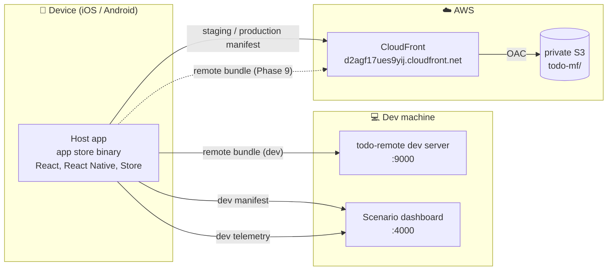
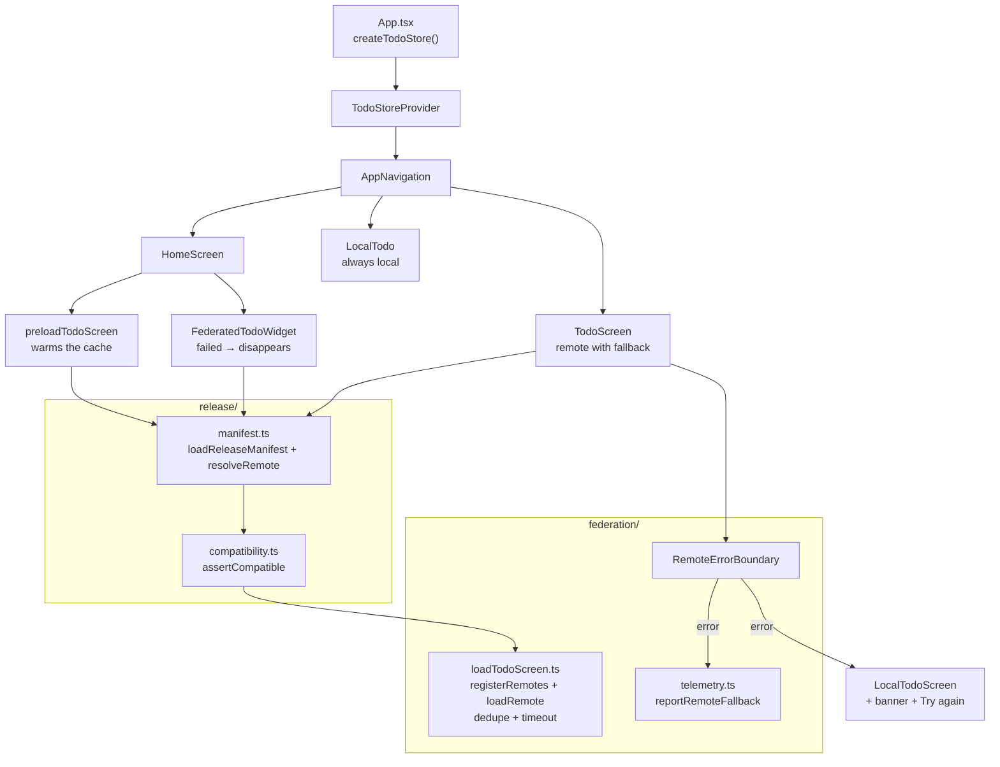
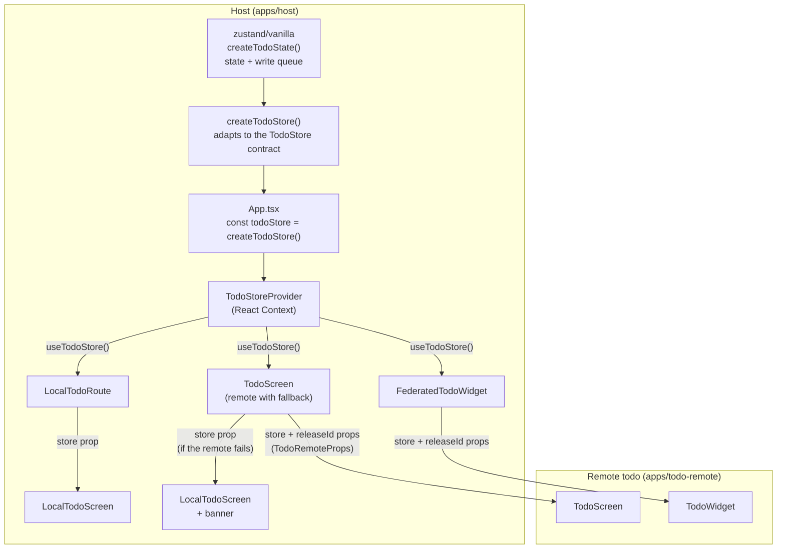
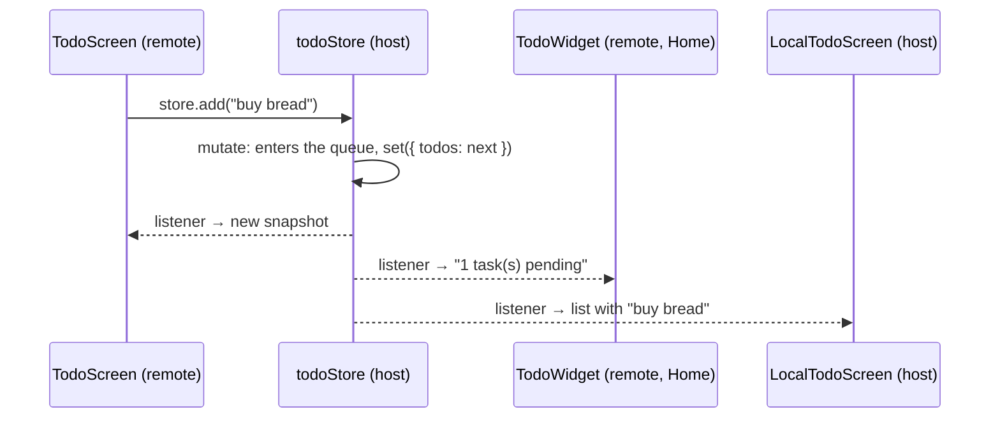
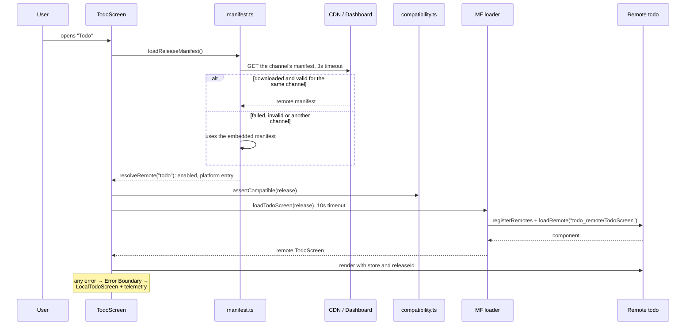
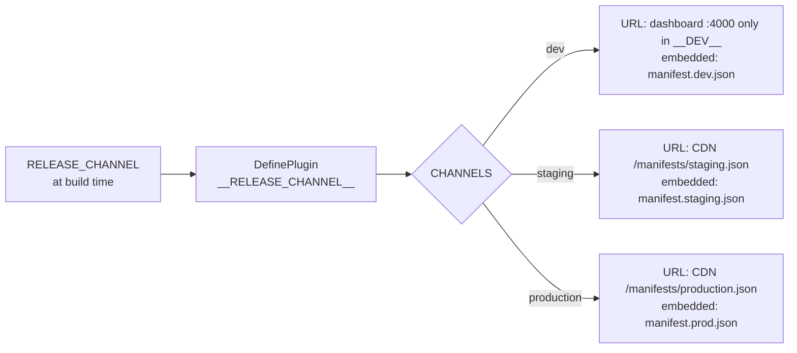
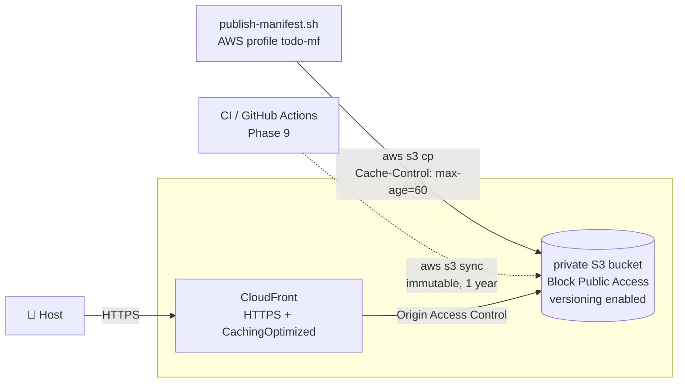
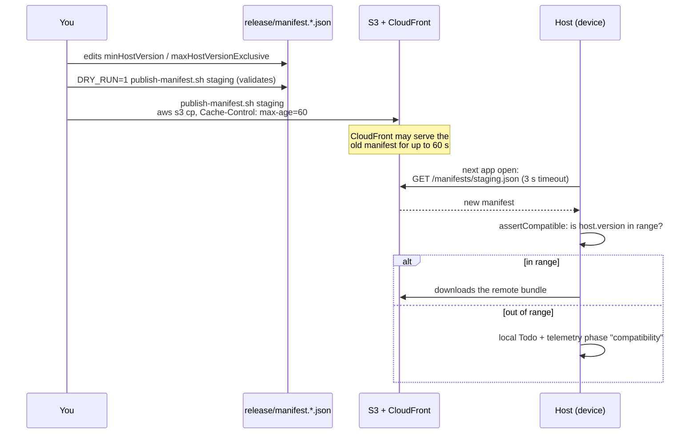

# Architecture — todo-mf

A tasks app in React Native (Expo + Re.Pack) split into a **host** and a **remote** with Module Federation v2. The host is the app installed from the app store. The `todo` remote is JavaScript code downloaded at runtime. If the remote fails, the host shows its own Todo screen. A **manifest per channel** (dev / staging / production), served by a **CDN** (S3 + CloudFront), decides which version of the remote each app loads.

> The full step-by-step plan is in [`README.md`](./README.md) and [`apps/README.md`](./apps/README.md). This document describes **how the pieces fit together**.

> **Diagrams:** the `mermaid` blocks render on GitHub. To edit them in Excalidraw: **More tools → Mermaid to Excalidraw**, and paste the block's content.

---

## 1. System overview



| Piece | Where | Role |
|---|---|---|
| **Host** | `apps/host` | The installed app. Creates the store, the navigation and the local fallback Todo screen. Reads the manifest, checks compatibility and loads the remote. |
| **Remote `todo`** | `apps/todo-remote` | MF container `todo_remote` that exposes `./TodoScreen` and `./TodoWidget`. It has no state of its own: it receives the store through props. |
| **Contract** | `packages/todo-contract` | The `Todo`, `TodoStore` and `TodoRemoteProps` types, plus `CONTRACT_VERSION`. It is the only thing the host and the remote share in code. |
| **Manifests** | `release/manifest.*.json` | They state, per channel, whether the remote is enabled, the bundle URL per platform and the compatibility rules. |
| **CDN** | AWS S3 + CloudFront | Serves the staging and production manifests (today) and the remote bundles (Phase 9). |
| **Scenario dashboard** | `test-module-federation` repo (port 4000) | Dev only. Serves a manifest altered per scenario (simulated failures) and receives the telemetry. |

---

## 2. Repository structure

```text
todo-mf/
├── apps/
│   ├── host/                       # Expo + Re.Pack app (the app store binary)
│   │   ├── App.tsx                 # creates the TodoStore and mounts Provider + navigation
│   │   ├── navigation/             # stack: Home, Todo (remote), LocalTodo
│   │   ├── screens/                # HomeScreen, TodoScreen (federated), LocalTodoScreen (fallback)
│   │   ├── store/                  # todoStore (zustand vanilla, serialized writes) + Context
│   │   ├── federation/             # MF loader, Error Boundary, errors by phase, telemetry, preload
│   │   ├── release/                # manifest per channel, compatibility, dashboard URL
│   │   ├── rspack.config.mjs       # MF host + DefinePlugin(__RELEASE_CHANNEL__)
│   │   └── __tests__/              # store, loader, manifest and compatibility
│   └── todo-remote/                # MF container "todo_remote"
│       ├── src/TodoScreen.tsx      # full screen
│       ├── src/TodoWidget.tsx      # Home badge
│       └── rspack.config.mjs       # exposes + shared (react, react-native)
├── packages/
│   └── todo-contract/              # types + CONTRACT_VERSION
└── release/
    ├── manifest.dev.json           # points to localhost:9000
    ├── manifest.staging.json       # embedded staging (enabled: false)
    ├── manifest.prod.json          # embedded production (enabled: false)
    ├── publish-manifest.sh         # validates and publishes the manifest to S3
    ├── cdn.env.example             # template for the CDN target
    └── cdn.env                     # real bucket/account (not committed)
```

---

## 3. Inside the host



### Shared state
A single `TodoStore`, created in the host, feeds both the local and the remote screens. Details in [section 4](#4-shared-state-store-and-context).

### Shared dependencies (MF share scope)
| Lib | Host | Remote |
|---|---|---|
| `react` 19.2.3 | `singleton`, `eager: true` (provides) | `singleton`, `eager: false` (uses the host's) |
| `react-native` 0.86.3 | `singleton`, `eager: true` | `singleton`, `eager: false` |

A native module does **not** come through federation. If the remote needs something native, the host has to be published to the app store first.

---

## 4. Shared state: store and context

There is **one instance** of `TodoStore` in the whole app. It is created in the host and read by every Todo screen, local and remote. That is why a task added on the remote screen shows up on the local screen, in the fallback and in the Home widget, and vice versa.



### The three layers

**1. State: `store/todoStore.ts`.** The state lives in a `zustand/vanilla` store, which does not depend on React. Every write goes through `mutate`, which chains the operation onto a queue of Promises:

```ts
const mutate = (update: (current: readonly Todo[]) => readonly Todo[]) => {
  const run = queue.then(() => {
    set((state) => {
      const next = update(state.todos);
      return next === state.todos ? state : { todos: next };
    });
  });
  queue = run.catch(() => undefined);
  return run;
};
```

- Each `add` / `toggle` / `remove` reads the **most recent** snapshot inside the queue. Two simultaneous taps run one after the other and neither overwrites the other.
- If the operation changes nothing (for example, a `toggle` of a nonexistent id), `update` returns the same array and zustand notifies no one.
- An operation that fails does not stall the queue: `queue` continues from the `catch`.

**2. Contract: `createTodoStore()`.** zustand never leaves the host. `createTodoStore()` exposes only the `TodoStore` interface from `@todo-mf/todo-contract`:

```ts
return {
  getSnapshot: () => state.getState().todos,
  subscribe: (listener) => state.subscribe(() => listener()),
  add,
  toggle,
  remove,
};
```

- `getSnapshot` always returns the same reference while nothing changes, as `useSyncExternalStore` requires.
- `subscribe` drops zustand's `(state, prev)` arguments: the contract is `() => void`.
- The remote never imports zustand or anything from `store/`. Swapping the implementation (for example, to add persistence in Phase 4) does not change the contract.

**3. Distribution: `store/TodoStoreContext.tsx`.** `App.tsx` creates the store **once, outside the component**, and puts it in a Context:

```tsx
const todoStore = createTodoStore();

export default function App() {
  return (
    <TodoStoreProvider store={todoStore}>
      <AppNavigation />
    </TodoStoreProvider>
  );
}
```

- `useTodoStore()` takes the instance from the Context. It throws if used outside the Provider.
- `useTodos(store)` is the host's `useSyncExternalStore(store.subscribe, store.getSnapshot)`.

### Who reads the store, and how

| Component | Runs in | How it receives the store | How it reads |
|---|---|---|---|
| `LocalTodoRoute` → `LocalTodoScreen` | host | `useTodoStore()` → `store` prop | `useTodos(store)` |
| `TodoScreen` (fallback `LocalTodoScreen`) | host | `useTodoStore()` → `store` prop | `useTodos(store)` |
| remote `TodoScreen` | remote | `store` prop (`TodoRemoteProps`) | `useSyncExternalStore(...)` |
| remote `TodoWidget` | remote | `store` prop (`TodoRemoteProps`) | `useSyncExternalStore(...)` |

### Why Context in the host and props in the remote
- **Inside the host**, the Context avoids passing the store through the whole navigation.
- **At the federated boundary**, the store goes **through a prop**. The remote is another bundle: if it imported `TodoStoreContext`, it would have its own copy of the module and a different Context, with no Provider, and `useTodoStore()` would throw. With the prop, only the contract type has to match.
- `react` and `react-native` are `singleton` in the share scope, so the remote's `useSyncExternalStore` is the same React as the host's and subscribes to the same store.

### One write, every screen updated



Because local and remote read the same instance, switching to the fallback mid-session (the remote goes down, the Error Boundary takes over) keeps the tasks the user already had.

### Current limits
- State lives **in memory only**: closing the app loses the tasks. Persistence is Phase 4.
- Changing the shape of `TodoStore` is a **contract** change: it bumps `CONTRACT_VERSION` and, on a major, the old remote starts being rejected by `assertCompatible`.
- Tests in `apps/host/__tests__/todoStore.test.ts`: simultaneous `add`s keep their order, two `toggle`s in a row return to the original, and `getSnapshot` keeps the reference when nothing changes.

---

## 5. Flow when opening the Todo screen



### Failure phases
Any error becomes a `RemoteLoadError` with the phase in which it happened. The phase decides whether the "Try again" button appears (at most 2 retries).

| Phase | When it happens | Retry? |
|---|---|---|
| `manifest` | Remote missing, `enabled: false`, no entry for the platform, invalid schema | ❌ |
| `compatibility` | `runtimeApi`, contract major, React, RN or host version out of range | ❌ |
| `load` | Bundle 404, network error, module without `default` | ✅ |
| `timeout` | Remote load above 10 s | ✅ |
| `render` | The remote broke while rendering | ✅ |

Other points in the flow:
- **Manifest cache:** the manifest is fetched once per app run.
- **Loader dedupe:** simultaneous requests for the same `container@releaseId/module` share one Promise.
- **Bundle swap:** if the manifest changes the `entry`, the loader re-registers the container with `force`. This is how a rollback works without reinstalling the app.

---

## 6. Channels (dev / staging / production)

The channel is chosen **at build time**: `RELEASE_CHANNEL=staging` becomes the `__RELEASE_CHANNEL__` constant (via `DefinePlugin`), which selects the manifest URL and the embedded manifest.



| Channel | Remote manifest | Embedded manifest (if the remote one fails) |
|---|---|---|
| `dev` | Scenario dashboard (`localhost:4000` / `10.0.2.2:4000`), only in `__DEV__` | `manifest.dev.json`: remote enabled at `localhost:9000` |
| `staging` | `https://d2agf17ues9yij.cloudfront.net/todo-mf/manifests/staging.json` | `manifest.staging.json`: `enabled: false` |
| `production` | `https://d2agf17ues9yij.cloudfront.net/todo-mf/manifests/production.json` | `manifest.prod.json`: `enabled: false` |

Channel rules:
- **A manifest from another channel is rejected.** A staging manifest published to the production path falls back to the embedded one, instead of sending real users to a test build.
- **The staging and production embedded manifests are born disabled.** With no CDN, the app uses the local Todo, which is the safe behavior.
- **An invalid value in `RELEASE_CHANNEL` breaks the build.**

---

## 7. CDN (AWS)



### Pieces
| Piece | Configuration | Why |
|---|---|---|
| **S3** | Private, *Block all public access*, versioning enabled | No one reads the bucket directly. A file overwritten by mistake can be recovered. |
| **OAC** | Only CloudFront has read permission (bucket policy with `cloudfront.amazonaws.com`) | The bucket stays private. A nonexistent file answers **403**, not 404. |
| **CloudFront** | *Redirect HTTP to HTTPS*, `CachingOptimized` cache policy, no WAF | Delivers HTTPS and caches close to the user. The cache honors each file's `Cache-Control`, so no *invalidation* is needed. |
| **IAM** | `todo-mf-cli` user with write access only to `<bucket>/todo-mf/*` | A leaked credential only affects this prefix. |

### Bucket layout
```text
<bucket>/todo-mf/
├── manifests/
│   ├── staging.json            # mutable · Cache-Control: public, max-age=60
│   └── production.json         # mutable · Cache-Control: public, max-age=60
└── todo/                       # Phase 9
    ├── ios/<version>/todo_remote.container.js.bundle + chunks + assets
    └── android/<version>/...    # immutable · Cache-Control: public, max-age=31536000, immutable
```

### Rules
- **The manifest is the only mutable file.** With a 60 s cache, a rollback or kill switch reaches clients quickly.
- **Bundles live in per-version folders and are never overwritten.** A new version goes to a new folder.
- **The manifest always goes up last**, after the bundles. That way no client gets a URL that does not exist yet.
- **Sourcemaps** go to a private place, never to the public CDN.

### Publishing the manifests
```bash
release/publish-manifest.sh staging                  # official staging manifest
release/publish-manifest.sh production               # official production manifest
release/publish-manifest.sh staging --local-remote   # test: staging pointing to the remote on localhost
DRY_RUN=1 release/publish-manifest.sh staging        # validate only
```
Before uploading, the script:
- validates the schema and the channel;
- requires HTTPS on the entries (except with `--local-remote`);
- checks that the CLI profile is logged in to the right account (`CDN_ACCOUNT_ID`).

The target lives in `release/cdn.env`, which is **not committed**, because the repository is public.

### Operations
| Action | How | Effect |
|---|---|---|
| **Kill switch** | Publish the manifest with `enabled: false` | Everyone goes to the local Todo on the next app open |
| **Rollback** | Publish the manifest with the `releaseId`/`entries` of the previous version | Reverts without going through the app store. Those who already have the module in memory only swap on restart. |
| **Rollout %** | `rolloutPercent` + `previous` in the manifest | Phase 6 (does not exist yet) |
| **Contract change (major) or a new native module** | Publish a new host to the app store and only then bump `minHostVersion` | The manifest alone does not solve it |

### Scenario: changing the host range (`minHostVersion` / `maxHostVersionExclusive`)

The range states **which app store binaries** can load the remote's release. The host compares its own version (`expo.version` from `app.json`, embedded in the binary) with the interval `[minHostVersion, maxHostVersionExclusive)`:

```ts
// apps/host/release/compatibility.ts
if (compareVersions(host.version, c.minHostVersion) < 0) problems.push(`host ${host.version} < ${c.minHostVersion}`);
if (compareVersions(host.version, c.maxHostVersionExclusive) >= 0)
  problems.push(`host ${host.version} >= ${c.maxHostVersionExclusive}`);
```

Out of range, the host throws `RemoteLoadError('compatibility')` **before downloading the bundle**. The screen opens straight into the local Todo, with no "Try again", and telemetry records the reason.

**The story:** the app store has host `1.0.0`. Host `1.1.0` ships, and the next remote release only works on it.

| Step | Manifest | Host `1.0.0` | Host `1.1.0` |
|---|---|---|---|
| 1. Today | `min 1.0.0` · `max 2.0.0` | ✅ loads the remote | ✅ loads the remote |
| 2. New remote requires the new host | `min 1.1.0` · `max 2.0.0` | ⛔ `host 1.0.0 < 1.1.0` → local Todo | ✅ loads the new remote |
| 3. Rollback | back to `min 1.0.0` | ✅ loads again | ✅ loads |
| 4. Host `2.0.0` ships (contract 2) | the old release stays at `max 2.0.0` | ✅ | ✅ (host `2.0.0` rejects that release: `host 2.0.0 >= 2.0.0`) |

> Today the manifest has **one release per channel**. In step 2, those on host `1.0.0` do not get the previous release: they go to the local Todo. Serving a different release for each range is Phase 6 (`previous` in the manifest).

#### How the change reaches the app without a host build



**In staging / production (server = S3 + CloudFront):**

```bash
# 1. edit the range
#    release/manifest.staging.json → remotes.todo.compatibility
#      "minHostVersion": "1.1.0",
#      "maxHostVersionExclusive": "2.0.0"

# 2. validate without touching AWS (schema, channel, HTTPS on the entries)
DRY_RUN=1 release/publish-manifest.sh staging

# 3. publish (overwrites <bucket>/todo-mf/manifests/staging.json)
release/publish-manifest.sh staging

# 4. check what the CDN is serving
curl -s https://d2agf17ues9yij.cloudfront.net/todo-mf/manifests/staging.json | jq '.remotes.todo.compatibility'
```

- Only the **manifest** changes. No bundle is re-uploaded, and the host does not go through the app store.
- CloudFront honors the `max-age=60`: within a minute all points of presence serve the new manifest, with no *invalidation*.
- The app reads the manifest **once per run** (`loadReleaseManifest` keeps the Promise). Those with the app open only see the change on reopen.
- The rollback is the same command, with the old values.

**In dev (server = scenario dashboard, port 4000):**

- **Without editing a file:** the **"Host out of range (min 1.1.0)"** scenario changes `minHostVersion` in the manifest the dashboard serves. With "reload the app on switch" checked, the app reloads on its own.
- **Editing the file:** the dashboard re-reads `release/manifest.dev.json` on every `GET /manifest.json`. Change the range, save and click **Reload app**.
- **Simulating host `1.1.0`:** since the host reads the version from `app.json` in the JS bundle, in dev it is enough to change `expo.version` to `1.1.0` and reload. In production, that version only changes with a new build in the app store.

The result shows up in **Live events**: right after the `manifest` comes `telemetry [remote_fallback] todo/TodoWidget · phase "compatibility" · Remote todo-dev-local incompatible: host 1.0.0 < 1.1.0`, and no bundle `request`. The badge disappears from Home. On opening the Todo screen, the same event arrives for `todo`.

---


https://github.com/user-attachments/assets/5c3397dd-019b-41f6-9304-60cbb1359fc8


https://youtu.be/1VVwEp2Hrlg


