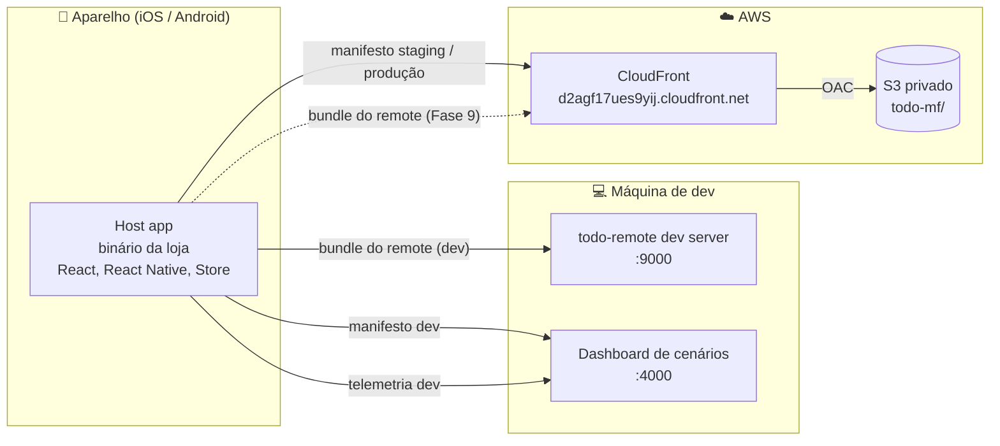
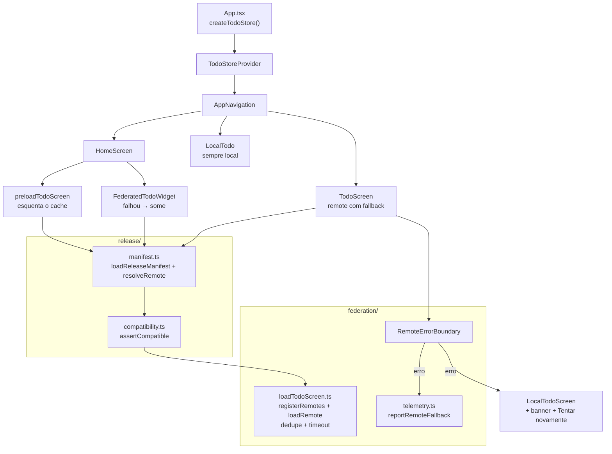
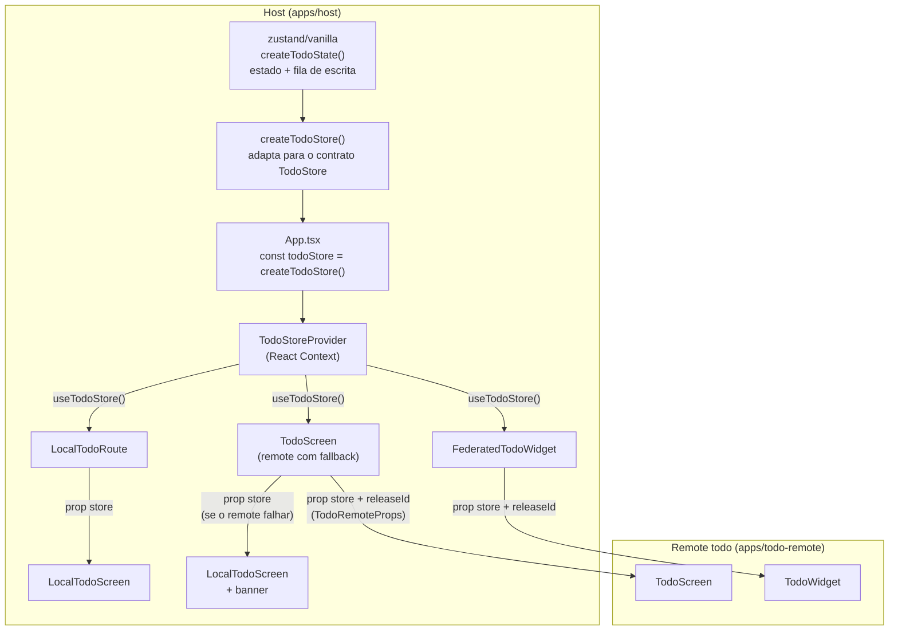
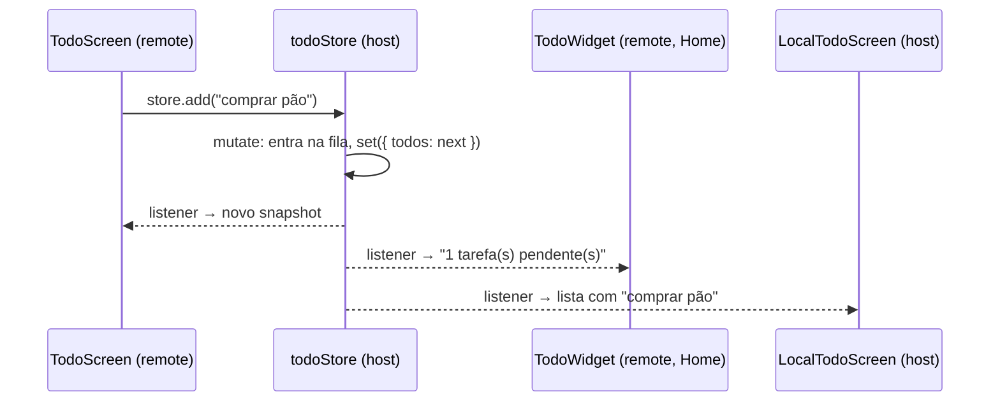
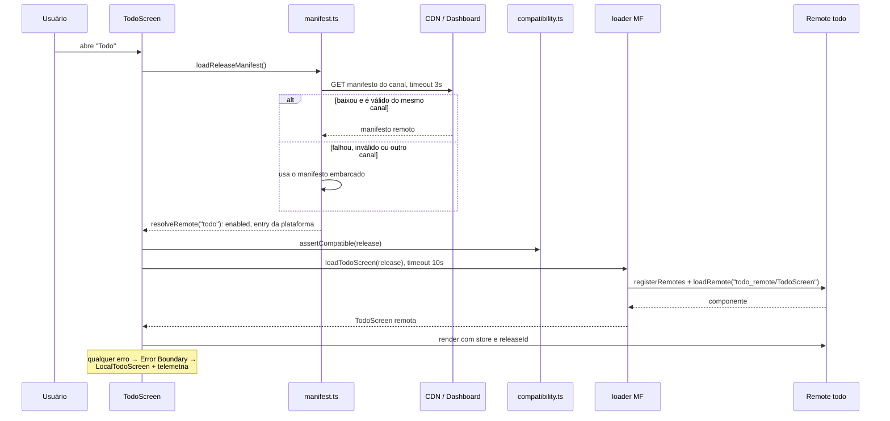
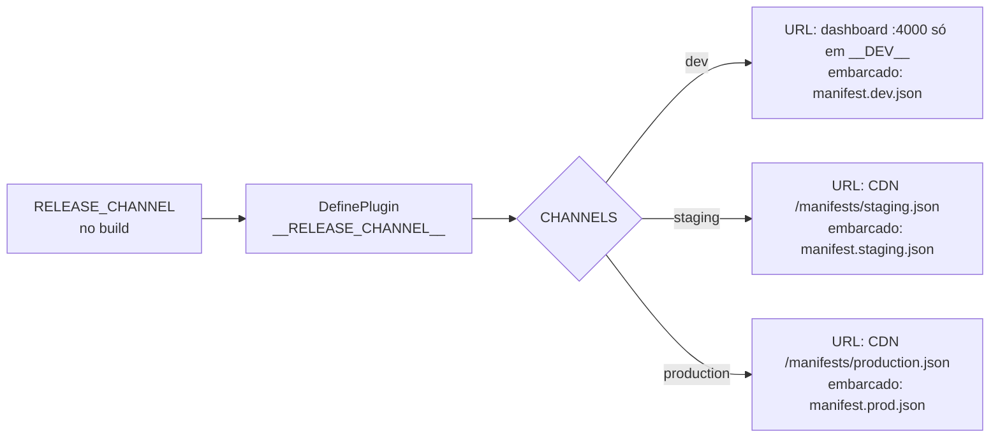
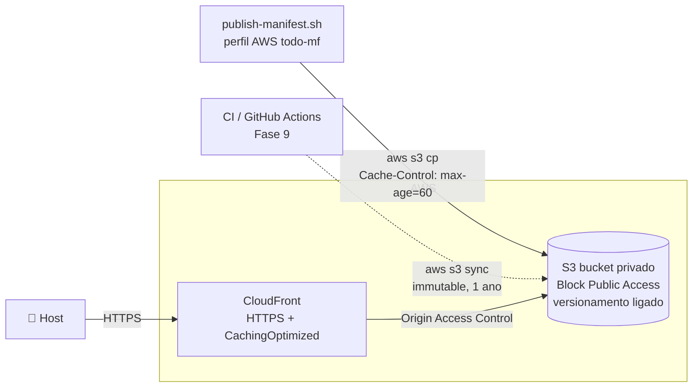
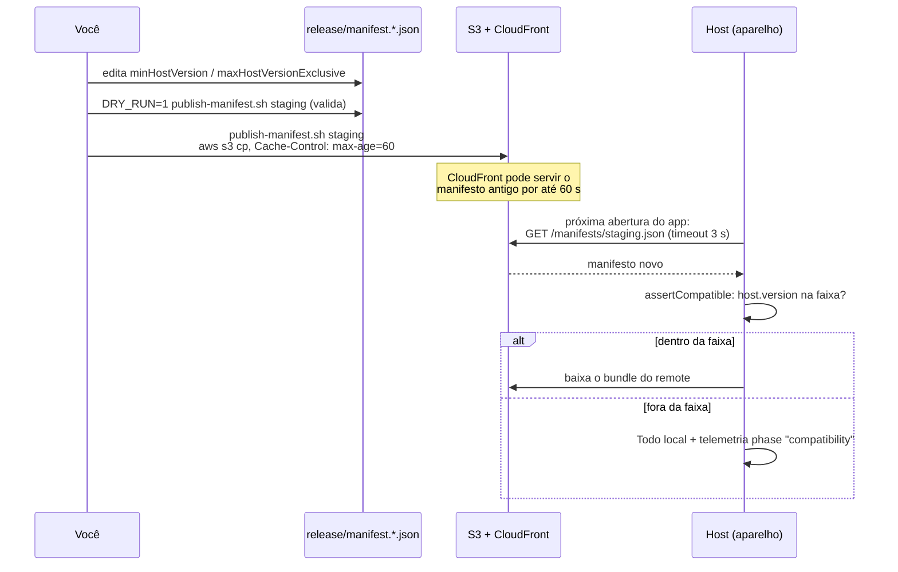

# Arquitetura — todo-mf

App de tarefas em React Native (Expo + Re.Pack) dividido em **host** e **remote** com Module Federation v2. O host é o app instalado pela loja. O remote `todo` é código JavaScript baixado em runtime. Se o remote falhar, o host mostra uma tela Todo própria. Um **manifesto por canal** (dev / staging / produção), servido por uma **CDN** (S3 + CloudFront), decide qual versão do remote cada app carrega.

> O plano completo, passo a passo, está em [`README.md`](./README.md) e [`apps/README.md`](./apps/README.md). Este documento descreve **como as peças se encaixam**.

> **Diagramas:** os blocos `mermaid` aparecem renderizados no GitHub. Para editar no Excalidraw: **More tools → Mermaid to Excalidraw**, e cole o conteúdo do bloco.

---

## 1. Visão geral do sistema



| Peça | Onde | Papel |
|---|---|---|
| **Host** | `apps/host` | App instalado. Cria o store, a navegação e a tela Todo local de fallback. Lê o manifesto, checa compatibilidade e carrega o remote. |
| **Remote `todo`** | `apps/todo-remote` | Container MF `todo_remote` que expõe `./TodoScreen` e `./TodoWidget`. Não tem estado próprio: recebe o store por props. |
| **Contrato** | `packages/todo-contract` | Tipos `Todo`, `TodoStore` e `TodoRemoteProps`, mais `CONTRACT_VERSION`. É a única coisa que host e remote compartilham em código. |
| **Manifestos** | `release/manifest.*.json` | Dizem, por canal, se o remote está ligado, a URL do bundle por plataforma e as regras de compatibilidade. |
| **CDN** | AWS S3 + CloudFront | Serve os manifestos de staging e produção (hoje) e os bundles do remote (Fase 9). |
| **Dashboard de cenários** | repo `test-module-federation` (porta 4000) | Só em dev. Serve um manifesto alterado por cenário (falhas simuladas) e recebe a telemetria. |

---

## 2. Estrutura do repositório

```text
todo-mf/
├── apps/
│   ├── host/                       # app Expo + Re.Pack (o binário da loja)
│   │   ├── App.tsx                 # cria o TodoStore e monta Provider + navegação
│   │   ├── navigation/             # stack: Home, Todo (remote), LocalTodo
│   │   ├── screens/                # HomeScreen, TodoScreen (federada), LocalTodoScreen (fallback)
│   │   ├── store/                  # todoStore (zustand vanilla, escrita serializada) + Context
│   │   ├── federation/             # loader MF, Error Boundary, erros por fase, telemetria, preload
│   │   ├── release/                # manifesto por canal, compatibilidade, URL do dashboard
│   │   ├── rspack.config.mjs       # MF host + DefinePlugin(__RELEASE_CHANNEL__)
│   │   └── __tests__/              # store, loader, manifesto e compatibilidade
│   └── todo-remote/                # container MF "todo_remote"
│       ├── src/TodoScreen.tsx      # tela completa
│       ├── src/TodoWidget.tsx      # badge da Home
│       └── rspack.config.mjs       # exposes + shared (react, react-native)
├── packages/
│   └── todo-contract/              # tipos + CONTRACT_VERSION
└── release/
    ├── manifest.dev.json           # aponta para localhost:9000
    ├── manifest.staging.json       # embarcado de staging (enabled: false)
    ├── manifest.prod.json          # embarcado de produção (enabled: false)
    ├── publish-manifest.sh         # valida e publica o manifesto no S3
    ├── cdn.env.example             # modelo do destino da CDN
    └── cdn.env                     # bucket/conta reais (não commitado)
```

---

## 3. Dentro do host



### Estado compartilhado
Um único `TodoStore`, criado no host, alimenta as telas locais e as remotas. Detalhes na [seção 4](#4-estado-compartilhado-store-e-contexto).

### Dependências compartilhadas (share scope do MF)
| Lib | Host | Remote |
|---|---|---|
| `react` 19.2.3 | `singleton`, `eager: true` (fornece) | `singleton`, `eager: false` (usa a do host) |
| `react-native` 0.86.3 | `singleton`, `eager: true` | `singleton`, `eager: false` |

Módulo nativo **não** vem pela federação. Se o remote precisar de algo nativo, o host precisa ser publicado na loja antes.

---

## 4. Estado compartilhado: store e contexto

Existe **uma instância** de `TodoStore` no app inteiro. Ela é criada no host e lida por todas as telas Todo, locais e remotas. Por isso uma tarefa adicionada na tela remota aparece na tela local, no fallback e no widget da Home, e vice-versa.



### As três camadas

**1. Estado: `store/todoStore.ts`.** O estado fica num store `zustand/vanilla`, que não depende de React. Toda escrita passa por `mutate`, que encadeia a operação numa fila de Promises:

```ts
const mutate = (update: (current: readonly Todo[]) => readonly Todo[]) => {
  const run = queue.then(() => {
    set((state) => {
      const next = update(state.todos);
      return next === state.todos ? state : { todos: next };
    });
  });
  queue = run.catch(() => undefined);
  return run;
};
```

- Cada `add` / `toggle` / `remove` lê o snapshot **mais recente** dentro da fila. Dois toques simultâneos rodam um depois do outro e nenhum sobrescreve o outro.
- Se a operação não muda nada (por exemplo, `toggle` de um id inexistente), `update` devolve o mesmo array e o zustand não notifica ninguém.
- Uma operação que falhe não trava a fila: `queue` segue a partir do `catch`.

**2. Contrato: `createTodoStore()`.** O zustand não sai do host. `createTodoStore()` expõe só a interface `TodoStore` de `@todo-mf/todo-contract`:

```ts
return {
  getSnapshot: () => state.getState().todos,
  subscribe: (listener) => state.subscribe(() => listener()),
  add,
  toggle,
  remove,
};
```

- `getSnapshot` devolve sempre a mesma referência enquanto nada muda, como `useSyncExternalStore` exige.
- `subscribe` descarta os argumentos `(state, prev)` do zustand: o contrato é `() => void`.
- O remote nunca importa zustand nem nada de `store/`. Trocar a implementação (por exemplo, para adicionar persistência na Fase 4) não muda o contrato.

**3. Distribuição: `store/TodoStoreContext.tsx`.** `App.tsx` cria o store **uma vez, fora do componente**, e o coloca num Context:

```tsx
const todoStore = createTodoStore();

export default function App() {
  return (
    <TodoStoreProvider store={todoStore}>
      <AppNavigation />
    </TodoStoreProvider>
  );
}
```

- `useTodoStore()` pega a instância do Context. Ele lança erro se for usado fora do Provider.
- `useTodos(store)` é o `useSyncExternalStore(store.subscribe, store.getSnapshot)` do host.

### Quem lê o store, e como

| Componente | Roda em | Como recebe o store | Como lê |
|---|---|---|---|
| `LocalTodoRoute` → `LocalTodoScreen` | host | `useTodoStore()` → prop `store` | `useTodos(store)` |
| `TodoScreen` (fallback `LocalTodoScreen`) | host | `useTodoStore()` → prop `store` | `useTodos(store)` |
| `TodoScreen` remota | remote | prop `store` (`TodoRemoteProps`) | `useSyncExternalStore(...)` |
| `TodoWidget` remoto | remote | prop `store` (`TodoRemoteProps`) | `useSyncExternalStore(...)` |

### Por que Context no host e props no remote
- **Dentro do host**, o Context evita passar o store por toda a navegação.
- **No limite federado**, o store vai **por prop**. O remote é outro bundle: se ele importasse `TodoStoreContext`, teria a própria cópia do módulo e um Context diferente, sem Provider, e `useTodoStore()` lançaria erro. Com a prop, só o tipo do contrato precisa coincidir.
- `react` e `react-native` são `singleton` no share scope, então o `useSyncExternalStore` do remote é o mesmo React do host e se inscreve no mesmo store.

### Uma escrita, todas as telas atualizadas



Como local e remote leem a mesma instância, a troca para o fallback no meio da sessão (remote cai, Error Boundary assume) mantém as tarefas que o usuário já tinha.

### Limites atuais
- O estado vive **só em memória**: fechar o app perde as tarefas. A persistência é a Fase 4.
- Mudar a forma de `TodoStore` é mudança de **contrato**: sobe `CONTRACT_VERSION` e, no major, o remote antigo passa a ser recusado por `assertCompatible`.
- Testes em `apps/host/__tests__/todoStore.test.ts`: `add` simultâneos mantêm ordem, dois `toggle` seguidos voltam ao original e `getSnapshot` mantém a referência quando nada muda.

---

## 5. Fluxo ao abrir a tela Todo



### Fases de falha
Qualquer erro vira um `RemoteLoadError` com a fase em que aconteceu. A fase decide se o botão "Tentar novamente" aparece (no máximo 2 tentativas).

| Fase | Quando acontece | Retry? |
|---|---|---|
| `manifest` | Remote ausente, `enabled: false`, sem entry para a plataforma, schema inválido | ❌ |
| `compatibility` | `runtimeApi`, major do contrato, React, RN ou versão do host fora da faixa | ❌ |
| `load` | Bundle 404, erro de rede, módulo sem `default` | ✅ |
| `timeout` | Carga do remote acima de 10 s | ✅ |
| `render` | O remote quebrou ao renderizar | ✅ |

Outros pontos do fluxo:
- **Cache do manifesto:** o manifesto é buscado uma vez por execução do app.
- **Dedupe do loader:** pedidos simultâneos para o mesmo `container@releaseId/módulo` compartilham uma Promise.
- **Troca de bundle:** se o manifesto mudar o `entry`, o loader re-registra o container com `force`. É assim que um rollback funciona sem reinstalar o app.

---

## 6. Canais (dev / staging / produção)

O canal é escolhido **no build**: `RELEASE_CHANNEL=staging` vira a constante `__RELEASE_CHANNEL__` (via `DefinePlugin`), que seleciona a URL do manifesto e o manifesto embarcado.



| Canal | Manifesto remoto | Manifesto embarcado (se o remoto falhar) |
|---|---|---|
| `dev` | Dashboard de cenários (`localhost:4000` / `10.0.2.2:4000`), só em `__DEV__` | `manifest.dev.json`: remote ligado em `localhost:9000` |
| `staging` | `https://d2agf17ues9yij.cloudfront.net/todo-mf/manifests/staging.json` | `manifest.staging.json`: `enabled: false` |
| `production` | `https://d2agf17ues9yij.cloudfront.net/todo-mf/manifests/production.json` | `manifest.prod.json`: `enabled: false` |

Regras do canal:
- **Manifesto de outro canal é recusado.** Um manifesto de staging publicado no caminho de produção cai no embarcado, em vez de mandar usuários reais para um build de teste.
- **Os embarcados de staging e produção nascem desligados.** Sem CDN, o app usa o Todo local, que é o comportamento seguro.
- **Valor inválido em `RELEASE_CHANNEL` quebra o build.**

---

## 7. CDN (AWS)



### Peças
| Peça | Configuração | Por quê |
|---|---|---|
| **S3** | Privado, *Block all public access*, versionamento ligado | Ninguém lê o bucket direto. Um arquivo sobrescrito por engano pode ser recuperado. |
| **OAC** | Só o CloudFront tem permissão de leitura (bucket policy com `cloudfront.amazonaws.com`) | O bucket continua privado. Arquivo inexistente responde **403**, não 404. |
| **CloudFront** | *Redirect HTTP to HTTPS*, cache policy `CachingOptimized`, sem WAF | Entrega HTTPS e cache perto do usuário. O cache respeita o `Cache-Control` de cada arquivo, então nenhuma *invalidation* é necessária. |
| **IAM** | Usuário `todo-mf-cli` com escrita só em `<bucket>/todo-mf/*` | Uma credencial vazada só afeta este prefixo. |

### Layout do bucket
```text
<bucket>/todo-mf/
├── manifests/
│   ├── staging.json            # mutável · Cache-Control: public, max-age=60
│   └── production.json         # mutável · Cache-Control: public, max-age=60
└── todo/                       # Fase 9
    ├── ios/<versão>/todo_remote.container.js.bundle + chunks + assets
    └── android/<versão>/...    # imutável · Cache-Control: public, max-age=31536000, immutable
```

### Regras
- **O manifesto é o único arquivo mutável.** Com cache de 60 s, um rollback ou kill switch chega rápido aos clientes.
- **Bundles ficam em pastas por versão e nunca são sobrescritos.** Versão nova vai para uma pasta nova.
- **O manifesto sobe sempre por último**, depois dos bundles. Assim, nenhum cliente recebe uma URL que ainda não existe.
- **Sourcemaps** vão para um lugar privado, nunca para a CDN pública.

### Publicação dos manifestos
```bash
release/publish-manifest.sh staging                  # manifesto oficial de staging
release/publish-manifest.sh production               # manifesto oficial de produção
release/publish-manifest.sh staging --local-remote   # teste: staging apontando para o remote em localhost
DRY_RUN=1 release/publish-manifest.sh staging        # só valida
```
Antes de subir, o script:
- valida o schema e o canal;
- exige HTTPS nas entries (exceto em `--local-remote`);
- confere se o perfil da CLI está logado na conta certa (`CDN_ACCOUNT_ID`).

O destino fica em `release/cdn.env`, que **não é commitado**, porque o repositório é público.

### Operação
| Ação | Como | Efeito |
|---|---|---|
| **Kill switch** | Publicar o manifesto com `enabled: false` | Todos vão para o Todo local na próxima abertura do app |
| **Rollback** | Publicar o manifesto com o `releaseId`/`entries` da versão anterior | Volta sem passar pela loja. Quem já tem o módulo em memória só troca ao reiniciar. |
| **Rollout %** | `rolloutPercent` + `previous` no manifesto | Fase 6 (ainda não existe) |
| **Mudança de contrato (major) ou módulo nativo novo** | Publicar um host novo na loja e só então subir `minHostVersion` | O manifesto sozinho não resolve |

### Cenário: mudar a faixa de host (`minHostVersion` / `maxHostVersionExclusive`)

A faixa diz **quais binários da loja** podem carregar o release do remote. O host compara a própria versão (`expo.version` do `app.json`, embarcada no binário) com o intervalo `[minHostVersion, maxHostVersionExclusive)`:

```ts
// apps/host/release/compatibility.ts
if (compareVersions(host.version, c.minHostVersion) < 0) problems.push(`host ${host.version} < ${c.minHostVersion}`);
if (compareVersions(host.version, c.maxHostVersionExclusive) >= 0)
  problems.push(`host ${host.version} >= ${c.maxHostVersionExclusive}`);
```

Fora da faixa, o host lança `RemoteLoadError('compatibility')` **antes de baixar o bundle**. A tela abre direto no Todo local, sem "Tentar novamente", e a telemetria registra o motivo.

**A história:** a loja tem o host `1.0.0`. Sai o host `1.1.0`, e o próximo release do remote só funciona nele.

| Passo | Manifesto | Host `1.0.0` | Host `1.1.0` |
|---|---|---|---|
| 1. Hoje | `min 1.0.0` · `max 2.0.0` | ✅ carrega o remote | ✅ carrega o remote |
| 2. Remote novo exige o host novo | `min 1.1.0` · `max 2.0.0` | ⛔ `host 1.0.0 < 1.1.0` → Todo local | ✅ carrega o remote novo |
| 3. Rollback | volta para `min 1.0.0` | ✅ volta a carregar | ✅ carrega |
| 4. Sai o host `2.0.0` (contrato 2) | release antigo continua com `max 2.0.0` | ✅ | ✅ (o host `2.0.0` recusa esse release: `host 2.0.0 >= 2.0.0`) |

> Hoje o manifesto tem **um release por canal**. No passo 2, quem está no host `1.0.0` não recebe o release anterior: vai para o Todo local. Servir um release diferente para cada faixa é a Fase 6 (`previous` no manifesto).

#### Como a mudança chega ao app sem build do host



**Em staging / produção (servidor = S3 + CloudFront):**

```bash
# 1. editar a faixa
#    release/manifest.staging.json → remotes.todo.compatibility
#      "minHostVersion": "1.1.0",
#      "maxHostVersionExclusive": "2.0.0"

# 2. validar sem tocar na AWS (schema, canal, HTTPS nas entries)
DRY_RUN=1 release/publish-manifest.sh staging

# 3. publicar (sobrescreve <bucket>/todo-mf/manifests/staging.json)
release/publish-manifest.sh staging

# 4. conferir o que a CDN está servindo
curl -s https://d2agf17ues9yij.cloudfront.net/todo-mf/manifests/staging.json | jq '.remotes.todo.compatibility'
```

- Só o **manifesto** muda. Nenhum bundle é reenviado, e o host não passa pela loja.
- O CloudFront respeita o `max-age=60`: em até 1 minuto todos os pontos de presença servem o manifesto novo, sem *invalidation*.
- O app lê o manifesto **uma vez por execução** (`loadReleaseManifest` guarda a Promise). Quem está com o app aberto só vê a mudança ao reabrir.
- O rollback é o mesmo comando, com os valores antigos.

**Em dev (servidor = dashboard de cenários, porta 4000):**

- **Sem editar arquivo:** o cenário **"Host fora da faixa (min 1.1.0)"** altera `minHostVersion` no manifesto que o dashboard entrega. Com "recarregar o app ao trocar" marcado, o app recarrega sozinho.
- **Editando o arquivo:** o dashboard relê `release/manifest.dev.json` a cada `GET /manifest.json`. Mude a faixa, salve e clique em **Recarregar app**.
- **Simulando o host `1.1.0`:** como o host lê a versão do `app.json` no bundle JS, em dev basta mudar `expo.version` para `1.1.0` e recarregar. Em produção, essa versão só muda com um build novo na loja.

O resultado aparece em **Eventos ao vivo**: logo depois do `manifest` vem `telemetry [remote_fallback] todo/TodoWidget · phase "compatibility" · Remote todo-dev-local incompatible: host 1.0.0 < 1.1.0`, e nenhum `request` de bundle. O selo some da Home. Ao abrir a tela Todo, chega o mesmo evento para `todo`.

---


https://github.com/user-attachments/assets/5c3397dd-019b-41f6-9304-60cbb1359fc8


